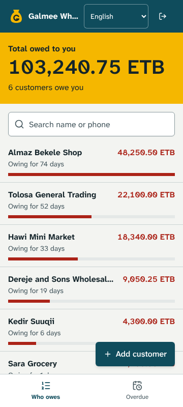
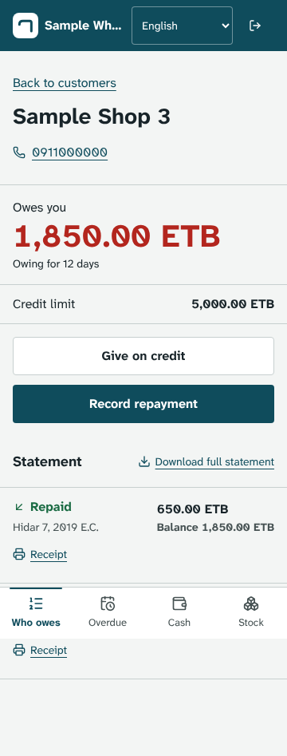
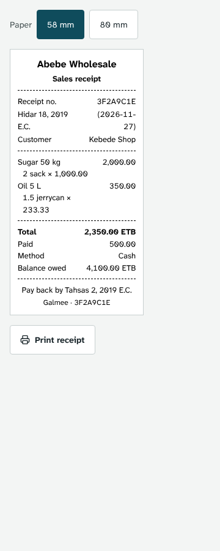

# Galmee Wholesale

Your notebook says people owe you money. This shows exactly who, how much, and since when.

Part of **Galmee**, business systems for Ethiopian businesses, by Alpha. Mobile-first PWA in Amharic, Afaan Oromo and English, built for cheap Android phones (360 px wide).

Live: https://galmee-wholesale.vercel.app

| Who owes | Shop statement | Credit-sale receipt |
| --- | --- | --- |
|  |  |  |

Screens shown with sample data.

## What it does

- **Who owes:** shops sorted by amount owed, total owed, search by name or phone, over-limit warning.
- **Statement:** every debt and repayment per shop with a running balance; reprint any receipt.
- **Give on credit:** pick items, take part payment, the rest goes on the shop's book. Blocked above the shop's credit limit unless the owner overrides (the override is logged).
- **Repayments:** cash, Telebirr, CBE Birr, bank; never more than the shop owes; 58 mm receipt.
- **Overdue:** ageing buckets 0-30, 31-60 and over 60 days, per shop and in total.
- **Stock:** items, receive stock (owner or manager), take stock out for damaged, expired, own-use, returned or short-counted goods (oldest batch first).
- **Daily cash:** cash for the drawer, repayments, credit given and a per-method list for any day.
- **Download your records:** customers, credit book, payments, sales and items as CSV for Excel (owner or manager), with Gregorian and Ethiopian dates.

## Stack

- Frontend: Next.js 16 (App Router, Cache Components) + Tailwind v4 + shadcn/ui, installable PWA
- i18n: next-intl, routes `/am` (default), `/om`, `/en`; Ethiopian calendar in the UI, Gregorian in the database
- Backend: Supabase (shared Galmee project), Postgres row-level security per business; money and stock change only through database functions
- Planned: Chapa / Telebirr payments, AfroMessage SMS and Telegram alerts, all sent from Supabase Edge Functions

See `ROADMAP.md` for progress.

## Develop

```bash
cp .env.example .env.local   # public values only; secrets live in Supabase
npm ci
npm run dev                  # http://localhost:3000 -> /am
npm test                     # Vitest unit tests
npm run lint && npm run build
```

The service worker only registers in production builds (`npm run build && npm start`).

`npm run screenshots` saves 360 px and 1280 px screenshots in Amharic and English to `docs/screenshots/` (needs `npm start` running; fails on page errors or horizontal scroll). Extra logged-in screens: `SHOT_EXTRA="cash:/cash,export:/export" npm run screenshots` with a logged-in session.

## Environment variables

| Name | Where | What |
| --- | --- | --- |
| `NEXT_PUBLIC_SUPABASE_URL` | `.env.local`, Vercel | Supabase project URL |
| `NEXT_PUBLIC_SUPABASE_PUBLISHABLE_KEY` | `.env.local`, Vercel | Publishable (public) key; row-level security protects the data |

There are no server secrets in this app. SMS, Telegram and payment keys are Supabase Edge Function secrets and never reach the frontend or this repository.

## Database

The core tables (businesses, staff, customers, items, sales, payments, credit ledger) are shared by all Galmee products. This app adds only objects starting with `wh_`:

- `supabase/migrations/`: the `wh_` migrations, in the order they were applied.
- `supabase/tests/`: SQL tests for row-level security and the `wh_` functions. Each test runs in one block and raises an exception at the end, so nothing is kept; the exception message is the result (expected values are written next to each figure). Run them in the Supabase SQL editor.
- After a schema change, regenerate `src/lib/supabase/database.types.ts` from the Supabase project.

## Deploy

Vercel builds and deploys every push to `main`. A new deployment needs the two environment variables above. Security headers and a per-request Content Security Policy are set in `src/proxy.ts` and `next.config.ts`.

## Layout

- `src/app/[locale]/` pages (`(auth)` login and signup, `(app)` the logged-in screens), `src/app/api/export/` CSV downloads
- `src/server/dal/` all database reads and writes (server only); `src/actions/` form actions, validated with zod in `src/server/validation.ts`
- `src/components/galmee/` the shared Galmee design system; `src/components/` this app's forms and shell
- `src/lib/` Ethiopian calendar, money, receipt, daily cash and CSV helpers (with tests)
- `src/i18n/` next-intl routing; `messages/*.json` every visible string in am, om and en
- `public/sw.js` offline shell, `src/app/manifest.ts` PWA manifest
